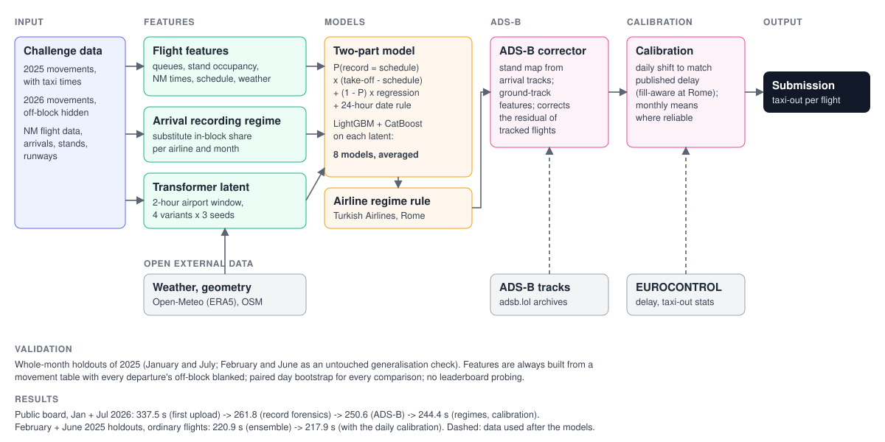
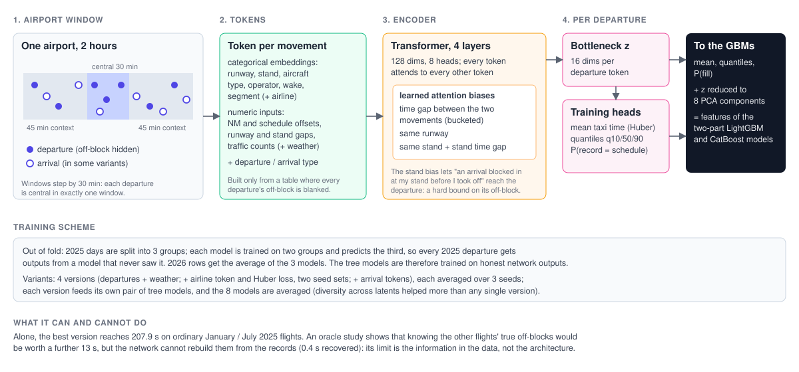
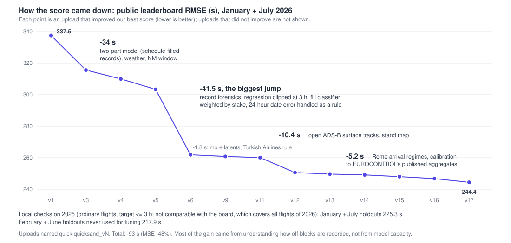

# Method: taxi-out time prediction, PRC Data Challenge 2026

Team quick-quicksand. This document describes the submitted solution, how it was validated and what
did not work. Numbers are RMSE in seconds. Experiment details live in `docs/experiment_log.md`
(EXP-xxx), the validation protocol in `docs/validation.md`.

## 1. Task

For each of the 344,841 departures of January and July 2026 at ten European airports (EDDF, EDDM,
EGLL, EHAM, LEBL, LEMD, LFPG, LIRF, LSZH, LTFM), predict the taxi-out time recorded in the movement
data: take-off minus off-block. The score is the RMSE over all departures. The ranking file is
post-operations: every departure's take-off time, runway, stand and Network Manager (NM) times are
known, and so is every arrival; only departures' off-block and taxi time are blank. Training data:
the same tables for 2025, with labels.

## 2. What the data taught us

The RMSE is decided by records, not by taxiing aircraft. Most of the work went into understanding
how the recorded off-block is produced.

- **The tail decides the score.** 0.01% of flights carry a third of the squared error; Rome (LIRF)
  is 7% of departures and about half of the error.
- **Schedule-filled off-blocks.** For 4.8% of departures (18% at LIRF) the recorded off-block equals
  the schedule to within 10 s, about five times chance. For those rows the target is take-off minus
  schedule, which produces most multi-hour "taxi-outs". The model is therefore a mixture (section 4).
- **NM matching window** (EXP-033): a departure carries an NM flight record only if its off-block is
  within 60 min of NM's last filed off-block time (LOBT); no exception in 2.06 million movements. An
  NM match bounds the off-block; its absence is informative.
- **24-hour date artefact** (EXP-034, EXP-039): at LIRF, a departure without NM match whose real
  off-block falls on a later local date than its schedule, at a time of day within 12 h of the
  scheduled one, is stored 24 h early (11 of 11 in 2025, none elsewhere). It is handled as a rule.
- **Recording regimes are visible in the arrivals.** At LIRF, across airline-months of 2025, the share
  of an airline's arrivals with substitute in-block times (in-block = schedule, or landing + 10 min)
  correlates 0.79 with the share of its departures with schedule-filled off-blocks. Arrivals are known in
  the ranking file, so the 2026 regimes are visible (EXP-054).
- **Recording regimes change.** Turkish Airlines' LIRF records switched to substitute block times on
  17 October 2025 (376 of 378 departures schedule-filled to year end; its arrivals show the same
  signature in January 2026, not in July): a rule for those 154 January rows (EXP-050).
- **Timestamps** at EDDM, EGLL, LFPG, LIRF and LTFM are minute values with about 6 s jitter; LEBL
  and LEMD targets are capped near 3,600 s.
- **Stand occupancy is a hard bound**: an arrival blocking in at the departure's stand before its
  take-off means the departure had pushed back before that.

## 3. Validation

- **Whole-month holdouts** (`docs/validation.md`, VAL-MONTH-V2): train on 2025 without January,
  test on January; same for July. These are the ranking months; random or day-based folds misled us.
- **Masked inputs**: features only ever read a movement table in which every departure's off-block
  and taxi time is blanked, exactly as in the ranking file. Estimated neighbour quantities are built
  out of fold.
- **Three scores**: all flights, "core" (target at most 3 h) and "clean" (core without
  schedule-filled records). The board tracks local core much better than local all, because the
  2025 tail does not repeat in 2026; decisions are taken on core and clean, tail changes on the
  full-year out-of-fold parts (202 rows above 3 h).
- **Paired day bootstrap** for every comparison; noise floor measured with latent seeds (about 1 s
  clean, 2 to 3 s core).
- **No leaderboard probing.** Every upload was justified by a logged local result before it was
  made, and no upload was made to learn from its score.

## 4. Model

### 4.1 Features (`src/prc/features/`)

Flight and schedule (airline, type, wake category, runway, stand, schedule and NM offsets of the
take-off), sequence and queue features at the airport and runway, stand occupancy bounds, arrival
features, schedule-relative features, hourly weather (Open-Meteo, ERA5-based) and airport geometry
(OpenStreetMap). Two-stage neighbour estimates: neighbours' taxi times estimated out of fold, then
used as features.

### 4.2 Learned flight-centred latent (`src/prc/latent_set/`)

A transformer over a 2-hour window of the airport's movements around each departure, trained to
predict the taxi time; its bottleneck vector is a feature of the tabular models. Four variants:
departures with weather; plus an airline token and a Huber loss (two seed sets); plus arrival
tokens. Each is averaged over three seeds and trained out of fold for 2025.

### 4.3 Two-part model (`src/prc/models/gbdt.py`, `TwoPartFill`)

prediction = P(fill) x (take-off - schedule) + (1 - P(fill)) x regression, with:

- the regression trained on targets clipped at 3 h (records at 58,000 to 88,000 s otherwise
  contaminate ordinary flights' leaves; EXP-036), Huber loss;
- P(fill) averaging a plain classifier and one weighted by each flight's stake (squared gap between
  fill and non-fill outcomes; EXP-038);
- the 24-hour artefact as a rule (EXP-039) and late LIRF departures without NM as fills (EXP-041).

Each of the four latents feeds a LightGBM (3-seed bag) and a CatBoost two-part model, all with the
arrival recording-regime features (same airline, airport and month substitute rate; EXP-054); the eight
models are averaged, then the Turkish Airlines rule is applied.

### 4.4 ADS-B corrector (`scripts/adsb/`, EXP-052/053)

Open ADS-B surface tracks from adsb.lol (ODbL / CC0; use confirmed by the organisers under the
open-data rule), January and July of 2025 and 2026.

- **Extraction**: points within 8 km of each airport below 3,000 ft.
- **Matching**: take-offs are detected in the tracks (last ground point before an airborne one);
  each departure is matched one to one by take-off time, NM callsign and aircraft type. Only
  inputs present in the ranking file are used, never the off-block.
- **Stand map**: arrival tracks that end at the recorded in-block time give the position of each
  recorded stand (1,700 stands, median spread 3 to 4 m).
- **Features**: time since the first ground point of the final session, stops and stopped time,
  distance of the first point to the departure's own stand, time since leaving the stand when seen
  there (within 60 s of the true off-block for 92% of such departures at EHAM), path length,
  distance to lift-off, speeds, time since the last stop.
- **Corrector**: a LightGBM (Huber 150, 3 seeds) learns the residual of the eight-model ensemble
  from these features on the 2025 out-of-fold predictions, on matched departures only, and corrects
  matched 2026 departures outside LIRF. Generic by design: no airport identity, coordinates or
  traffic counts, because receiver coverage changed between 2025 and 2026 (London 12% -> 71% of
  departures matched, Madrid 1% -> 73%, Munich 57% -> 97%, Frankfurt 73% -> 58%).
- **Evidence**: month folds, all / core / clean 299.83 / 234.59 / 209.76 -> 295.08 / 228.48 /
  203.06. A corrector trained without the tested airport keeps almost all of the gain, and the
  mean correction follows the mean residual in every bin of track depth, so the 2026 coverage
  change is not expected to break it. LIRF is excluded: its errors are fill uncertainty, which
  the tracks cannot resolve.

### 4.5 Calibration to EUROCONTROL's published aggregates (`scripts/protocol/apply_daily.py`, `apply_pru.py`)

EUROCONTROL publishes, on ansperformance.eu (source: EUROCONTROL), monthly taxi-out averages per airport
(organiser-approved) and the daily pre-departure delay per airport, which equals the daily sum of
max(0, off-block - schedule) over departures (2025: correlation 0.9997). Both are public EUROCONTROL data,
used under the challenge's open-data rule. Because the daily file is an aggregate of the same off-block
times the challenge hides, its effect is reported separately so that the model can be judged without it:
-1.1 s on the public board (quick-quicksand_v15 vs v14), and the fill-aware step at LIRF a further -2.4 s
(v17 vs v16); every upload before v15 used no daily aggregate.

- **Daily** (EXP-056): per airport and day, the shift that makes the predictions reproduce the published
  sum, half applied (2025: core 228.5 -> 227.6, better in both months and at every airport).
- **Fill-aware at LIRF** (EXP-056b): a schedule-filled record contributes nothing to that sum, a real late
  off-block contributes its delay. Per day, a common shift of the fill weights is solved to match the
  published sum (2025: LIRF 522.5 -> 513.4 on all flights). Worse elsewhere, where fills are not a
  substitute practice.
- **Monthly** (EXP-055): implied 2026 mean = published 2026 + the 2025 gap between our data and the
  published value; applied at 60% only where that gap transfers between months within 7 s (EGLL, LEBL,
  EHAM, LIRF, LEMD) and the bias exceeds twice that error.

## 5. Results (public board)

| Upload | Content | RMSE |
| --- | --- | --- |
| quick-quicksand_v1 | two-part model, first latent | 337.48 |
| quick-quicksand_v3 | + weather, LightGBM + CatBoost, seed bags | 315.57 |
| quick-quicksand_v5 | + NM window, 24-hour artefact | 303.32 |
| quick-quicksand_v6 | + clipped regression, stake-weighted fill, rule for the artefact | 261.81 |
| quick-quicksand_v9 | three latents | 260.77 |
| quick-quicksand_v11 | four latents + Turkish Airlines rule | 260.02 |
| quick-quicksand_v12 | + ADS-B corrector | 250.55 |
| quick-quicksand_v13 | + track-shape features | 249.60 |
| quick-quicksand_v14 | + monthly calibration to published averages | 249.10 |
| quick-quicksand_v15 | + daily calibration to published delay | 247.98 |
| quick-quicksand_v16 | + arrival recording-regime features | 246.73 |
| quick-quicksand_v17 | + fill-aware daily calibration at LIRF | 244.38 |

## 6. What did not work

Recorded with numbers in the experiment log: time-series foundation models and 15-min airport-state
latents (EXP-001 to 007); target encodings and inbound rotation (EXP-037); clipping the latent target
at 2 h (EXP-029); a fill calibrator; strike calendars (EXP-044, ceiling 0.05 s); auxiliary
surface-state heads for the latent network (EXP-047: the network cannot learn what the records do
not contain, although true neighbour off-blocks would be worth 13 s, EXP-046); record rules for
winter, LOBT floors and duplicate records (EXP-049, worse on the board); ADS-B neighbour queue
features and NM offsets inside the corrector (EXP-053); record forensics at LTFM and LFPG (no substitute
practice, no transferable residual structure); per-flight inbound substitute flags
(EXP-057); exact model fill probabilities in the fill-aware calibration (EXP-056c).

## 7. Reproduce

`WITH_OOF=1 scripts/reproduce.sh` (README): official files in `data/raw/`, then the stages check,
external, features, latent, models, oof, adsb and calib (-> `candidate_v21.parquet`, quick-quicksand_v17). The ADS-B stage downloads about 420 GB (single
stream, capped) to `ADSB_ROOT` and is deterministic: two rebuilds are byte-identical.
